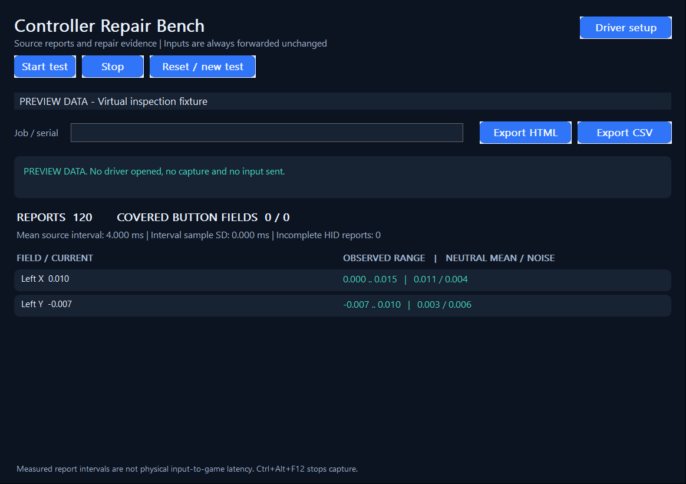

# Controller Repair Bench

**Live gamepad inspection and repair reports for Windows 10/11 x64.** Observe HID, XUSB/XInput, XInput HID and GIP controllers through [Interceptor Gamepad & Controller](https://github.com/TitanCSA/Interceptor-Gamepad-Controller). Captured reports are forwarded unchanged by one worker; the application never remaps a button.

<!-- full-version-contact:start -->
> [!IMPORTANT]
> **Get the full driver version without demo restrictions**
>
> **Discord username: `titancsa`**
>
> Open Discord, choose **Friends > Add Friend**, enter **`titancsa`**, then send a direct message. Ask for the **full driver version without the demo time limit**, and mention **Controller Repair Bench**.
>
> The demo limit belongs to **Interceptor Gamepad & Controller**, the driver used by this project. Ask for pricing and the appropriate license / activation instructions; the application or wrapper source keeps its existing license.
<!-- full-version-contact:end -->



See current axes, observed ranges, neutral drift/noise, exercised button fields and source-report intervals. Add a job or serial label and export a standalone HTML report or spreadsheet-friendly CSV. Multi-report HID fields retain their report, collection and data-index identity.

## Install and use

1. Download the application ZIP from [Releases](https://github.com/titanfyre/Controller-Repair-Bench/releases/latest) and extract it completely.
2. Open `Dependencies/InterceptorSetup.exe`, choose **Install / reinstall**, and restart Windows if requested. The driver is Microsoft-signed; signing is not a guarantee of compatibility with every controller or Windows configuration.
3. Open `ControllerRepairBench.exe`. Choose **Start test** and accept the administrator prompt. Input capture requires access to the driver; simply opening the app does not start a test.
4. Keep the sticks untouched while the status says **Sampling neutral**. Wait for **Neutral sample complete**, then move every axis through its range and exercise each button. Select a device from the menu, add your job label, and export HTML or CSV.
5. **Reset / new test** clears measurements and restarts neutral sampling. **Stop**, closing the app, or **Ctrl+Alt+F12** releases capture and restores passthrough.

Only devices that produce reports appear in the list. Normalized absolute axes use approximately -1..1; identified analog triggers use 0..1. Raw/unclassified fields are labelled. HID coverage counts fields present in observed reports, not an asserted total of every physical control. Native protocol bit fields can include reserved positions; an unexercised field is not automatically a faulty button. Incomplete decoding is counted and original reports still pass through.

**Report cadence is not end-to-end latency.** Intervals use driver report timestamps. Neutral sampling has one fixed three-second QPC window starting after capture initializes, or when the worker acknowledges Reset. Reports timestamped before that epoch are excluded. A device/field first observed after the window is marked **not sampled**, rather than starting another window when it first moves. Moving a stick during sampling invalidates a neutral interpretation. This is a diagnostic aid, not a hardware certification or automatic calibration tool.

## Demo and production licenses

All application features and user-mode source are available. The bundled driver is the **one-hour demo**, starting with the first capture after Windows starts and shared between applications using that driver. On expiry, interception ends and the driver returns to passthrough. Use Windows **Restart** to start another evaluation period.

For the production driver without the demo timer, commercial deployment, OEM integration or support: open Discord, select **Friends -> Add Friend**, enter **`titancsa`**, and send a message mentioning **Controller Repair Bench**. Production-driver licensing is separate from this application's MIT license; it does not promise game/anti-cheat compatibility. No customer key or private driver source is included here.

## Build and verify

Install Visual Studio 2022's Desktop development with C++ workload, a Windows SDK, and CMake. Run:

```powershell
./Build.ps1
./bin/ControllerRepairBench.exe --self-test
```

The C++17 build uses `/W4 /WX`. Offline fixtures cover statistics, native endpoint normalization, repeated HID axes, safe HTML/CSV formatting and bounded field expansion. `--preview` displays labelled fixture data; `--render-preview` writes `bin/Preview.bmp` and exits. These modes do not open the driver, capture input or send input. No online activation is performed by the app.

The unchanged two-file SDK is in `SDK/`. An authorized production build can select the matching licensed SDK without changing app code:

```powershell
cmake -S . -B obj/production -A x64 -DSDK_DIRECTORY="D:/YourLicensedGamepadSDK"
cmake --build obj/production --config Release
```

Install and activate the corresponding licensed driver using its supplied tools. Demo and production driver identities are separate. `Samples/` contains illustrative fixtures, not an automatic capture/import feature.

## License and responsible use

The application and bundled SDK user-mode source are MIT licensed; see `LICENSE` and `SDK/LICENSE`. Driver binaries have their own terms in `Dependencies/BINARY-LICENSE.txt`. The project is intended for authorized diagnostics, development and repair. You are responsible for your use and for compliance with applicable rules; the author provides no warranty and accepts no liability beyond applicable law.
